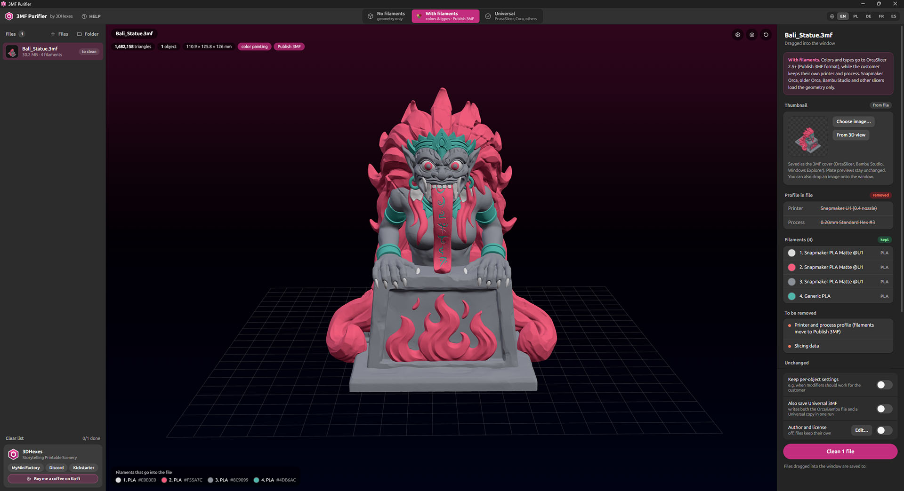
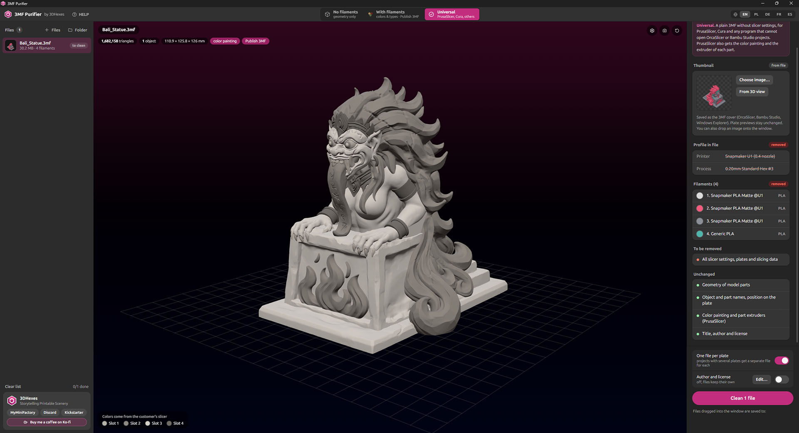
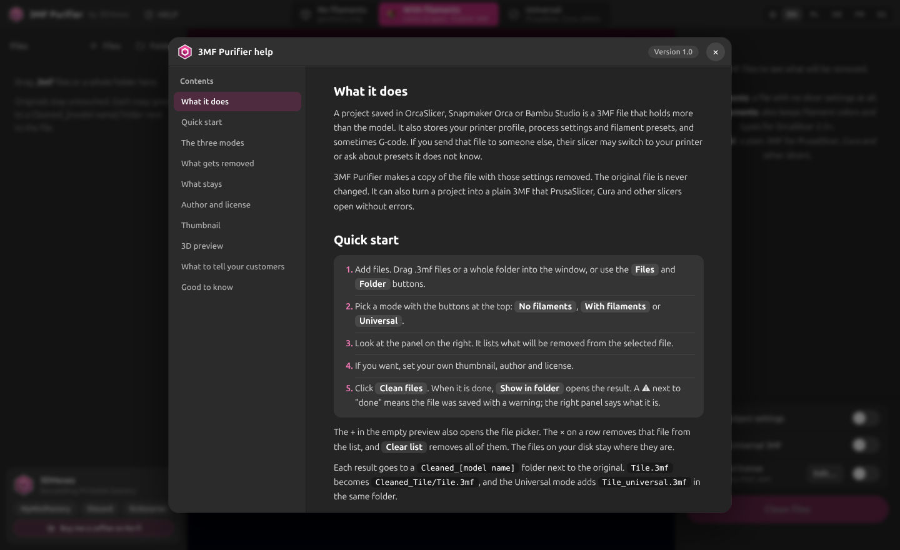

<p align="center">
  
</p>

<h1 align="center">3MF Purifier</h1>

<p align="center">
  Strip printer, process and filament settings out of 3MF files before you share them.<br>
  Free, offline, one small exe. By <a href="https://www.myminifactory.com/profile/3DHexes">3DHexes</a>.
</p>

<p align="center">
  <a href="../../releases/latest"></a>
  
  
  <a href="LICENSE"></a>
  <a href="README.pl.md"></a>
</p>



## Why

A project saved in OrcaSlicer, Snapmaker Orca or Bambu Studio is a 3MF file that holds more than the model. It also carries your printer profile, your process settings, your filament presets and often the G-code of the last slice. When a customer opens that file, their slicer may switch to your printer or ask about presets it has never seen.

I sell printable terrain and ran into this with every release, so I wrote a tool that makes a clean copy of the file. The model, its parts, the color painting and the plate layout stay. Everything that ties the file to my printer goes. The original file is never changed.

It works the other way round too. If you download a 3MF from MakerWorld or another store and it won't open in your slicer, or drags someone else's printer along, run it through the app.

## Download

Get the latest version from the [Releases page](../../releases/latest).

| System | File | How to run |
|---|---|---|
| Windows 10 / 11 (64-bit) | `3MF-Purifier-1.0-windows-x64.zip` | Unzip anywhere and start `3MF Purifier.exe`. Nothing gets installed. |
| Linux x64 / arm64 | `3MF-Purifier-1.0-linux-*.tar.gz` | Unpack and run `./install.sh` to add it to the app menu, or start `./3mf-purifier` directly. Needs WebKitGTK 4.1. |

The Windows exe is not code-signed yet, so SmartScreen may show "Windows protected your PC" on the first start. Click **More info**, then **Run anyway**.

## Three modes

| Mode | What you get | For people who use |
|---|---|---|
| **No filaments** | The same project with every slicer setting removed | OrcaSlicer, Bambu Studio |
| **With filaments** (default) | As above, plus the filament list (color, type, vendor) in OrcaSlicer's Publish 3MF format. Orca applies it to the customer's own slots and leaves their printer alone. | OrcaSlicer 2.5 and newer |
| **Universal** | A plain 3MF that follows the basic 3MF standard. Color painting and per-part extruders are written the way PrusaSlicer reads them. Projects with several plates become one file per plate. | PrusaSlicer, Cura and any slicer that can't open Orca or Bambu projects |

"Also save Universal 3MF" writes both versions in one run, which is handy if your store package should cover every slicer.



## What else it does

- Batch work: drop a whole folder, and every result lands in a `Cleaned_[model name]` folder next to its source.
- Privacy cleanup: full paths of the original STL files (which can contain your Windows user name) are cut to the file name, and MakerWorld print-profile data (profile author name and ID) is removed. The model's designer and license stay as they were.
- Author and license fields: optionally write your name, license and copyright into every file. OrcaSlicer and Bambu Studio show them in the project info.
- Custom cover thumbnail: pick an image, or render one straight from the 3D preview. Plate previews are not touched.
- 3D preview of the source and of the saved result, with filament colors and painting.
- English, Polish, German, French and Spanish. A built-in help window explains everything above in each language.



## What gets removed and what stays

Removed: the printer, process and filament profile (`project_settings.config`), embedded user presets, G-code and slicing data, color changes and pauses at a layer height, variable layer height, the PrusaSlicer profile, and settings attached to single objects or parts (you can keep these with one switch, so modifiers keep working).

Kept: geometry (copied byte for byte), object and part names, modifiers and negative parts (except in Universal), extruder assignment and color painting, plate layout and plate previews, and the model's title, designer and license.

## Telling your customers how to open the file

- **OrcaSlicer / Bambu Studio:** use File → Import, not Open Project. If asked, choose "Import geometry only". Orca may say the file comes from an older version; that message is harmless.
- **PrusaSlicer, Cura and others:** give them the `_universal.3mf` file.

## Building from source

The app is plain HTML, CSS and JavaScript on top of [Neutralino.js](https://neutralino.js.org/). Windows uses the Edge WebView2 runtime that ships with the system, which is why the exe is about 5 MB.

You need Node.js 18 or newer.

```sh
cd app
npx @neutralinojs/neu update                    # downloads the Neutralino binaries into app/bin
npx @neutralinojs/neu run                       # starts the app for development
npx @neutralinojs/neu build --embed-resources   # builds dist/3mf-purifier/3mf-purifier-win_x64.exe and the Linux binaries
```

There is no bundler and no framework. Third-party code (three.js, fflate, the Neutralino client) is vendored in `app/www/vendor` and `app/www/neutralino.js`.

Where things live:

| Path | What it does |
|---|---|
| `app/www/core/purify.js` | Cleaning engine for the two OrcaSlicer modes, Publish 3MF, thumbnails, privacy and author fields |
| `app/www/core/universal.js` | Universal 3MF writer: flattening parts, painting conversion for PrusaSlicer, plate splitting |
| `app/www/core/preview.js` | Mesh extraction for the 3D preview |
| `app/www/worker.js` | Runs the engine in a background worker so the window never freezes |
| `app/www/platform.js` | Everything that talks to the system: dialogs, reading and writing files, settings |
| `app/www/app.js` | The user interface |
| `app/www/i18n*.js`, `app/www/help-content.js` | Interface texts and help in five languages |

[docs/architecture.md](docs/architecture.md) describes the 3MF details: which files are removed, how Publish 3MF and the Universal conversion work, and how it was tested.

## Known limits

- Universal mode leaves out modifiers, negative parts and support blockers, because other slicers would print them as solid parts. The app warns when this changes the shape.
- Universal files were tested in PrusaSlicer 2.7 (painting and four extruders slice correctly) and against the official 3MF library in strict mode. They have not been tested in Cura yet.
- The Windows build has not been code-signed yet.

Found a file that doesn't come out right? [Open an issue](../../issues/new/choose) and attach it if you can, or drop by the [3DHexes Discord](https://discord.gg/MfkejWQZ4D).

## Support

3MF Purifier is free. If it saves you time, you can [buy me a coffee on Ko-fi](https://ko-fi.com/3dhexes), or have a look at the terrain I make:

- [MyMiniFactory](https://www.myminifactory.com/profile/3DHexes)
- [Kickstarter](https://www.kickstarter.com/profile/3dhexes/created)
- [Discord](https://discord.gg/MfkejWQZ4D)

## License

3MF Purifier is free software, released under the [GNU General Public License v3.0](LICENSE) with a few additional terms listed in [NOTICE](NOTICE).

In practice: anyone can use it for free, for any purpose, including cleaning files they sell. You can share it and change it. If you distribute a changed version, you have to publish its source code under the same license, give it a different name and credit "3MF Purifier by 3DHexes".

The 3DHexes name and logo, the app icon and the screenshots (they show 3DHexes models) are not covered by the GPL. Bundled third-party components keep their own licenses, listed in [THIRD-PARTY-LICENSES.txt](THIRD-PARTY-LICENSES.txt).
