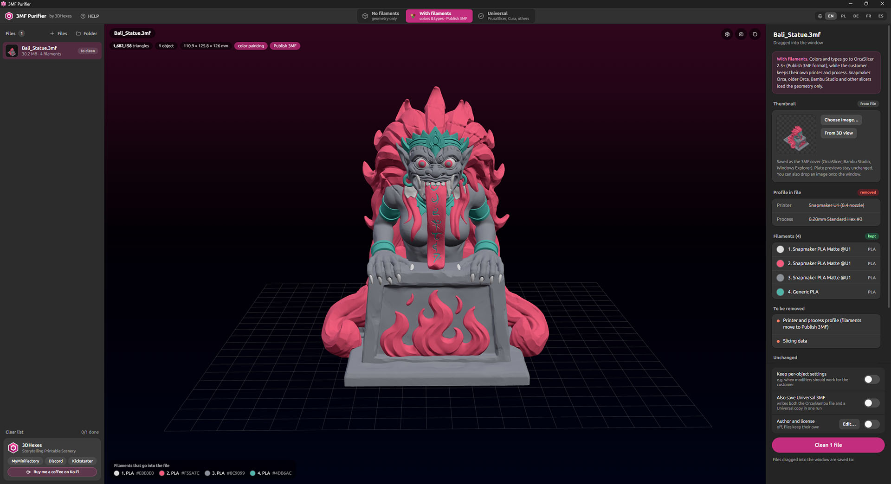

  

<h1 align="center">3MF Purifier</h1>

  Usuwa z plików 3MF ustawienia drukarki, procesu i filamentów, zanim je komuś przekażesz. 
  Darmowy, działa bez internetu, jeden mały plik exe. Od <a href="https://www.myminifactory.com/profile/3DHexes">3DHexes</a>.

<a href="README.md">English version</a>

## Po co to jest

Projekt zapisany w OrcaSlicerze, Snapmaker Orca albo Bambu Studio to plik 3MF, w którym oprócz modelu siedzi profil drukarki, ustawienia procesu, presety filamentów, a często też G-code z ostatniego cięcia. Kiedy klient otworzy taki plik, jego slicer może przełączyć się na twoją drukarkę albo pytać o presety, których nie zna.

Sprzedaję teren do druku 3D i trafiałem na to przy każdym wydaniu, więc napisałem narzędzie, które robi czystą kopię pliku. Model, jego części, malowanie kolorem i układ na płycie zostają. Znika wszystko, co wiąże plik z moją drukarką. Oryginał zostaje nietknięty.

Działa też w drugą stronę. Jeśli pobierzesz 3MF z MakerWorld albo innego sklepu i twój slicer go nie otwiera albo ciągnie za sobą cudzą drukarkę, przepuść go przez aplikację.

## Pobieranie

Najnowsza wersja jest na stronie [Releases](../../releases/latest).

| System | Plik | Jak uruchomić |
|---|---|---|
| Windows 10 / 11 (64-bit) | `3MF-Purifier-1.0-windows-x64.zip` | Rozpakuj gdziekolwiek i uruchom `3MF Purifier.exe`. Nic się nie instaluje. |
| Linux x64 / arm64 | `3MF-Purifier-1.0-linux-*.tar.gz` | Rozpakuj i uruchom `./install.sh`, żeby dodać program do menu, albo od razu `./3mf-purifier`. Wymaga WebKitGTK 4.1. |

Plik exe nie ma jeszcze podpisu cyfrowego, więc przy pierwszym uruchomieniu Windows może pokazać „System Windows ochronił ten komputer”. Kliknij **Więcej informacji**, a potem **Uruchom mimo to**.

## Trzy tryby

| Tryb | Co dostajesz | Dla kogo |
|---|---|---|
| **Bez filamentów** | Ten sam projekt bez żadnych ustawień slicera | OrcaSlicer, Bambu Studio |
| **Z filamentami** (domyślny) | Jak wyżej, plus lista filamentów (kolor, typ, producent) w formacie Publish 3MF. Orca nakłada ją na sloty klienta i nie rusza jego drukarki. | OrcaSlicer 2.5 i nowszy |
| **Uniwersalny** | Zwykły 3MF zgodny z podstawowym standardem. Malowanie kolorem i extrudery części są zapisane tak, jak czyta je PrusaSlicer. Projekt z kilkoma płytami daje osobny plik na płytę. | PrusaSlicer, Cura i slicery, które nie otwierają projektów z Orki ani Bambu |

Opcja „Zapisz też wersję Uniwersalną” zapisuje obie wersje naraz. Przydaje się, gdy paczka w sklepie ma pasować do każdego slicera.

## Co jeszcze potrafi

- Pracuje na całych folderach. Każdy wynik trafia do folderu `Cleaned_[nazwa modelu]` obok źródła.
- Dba o prywatność: pełne ścieżki plików STL (w których bywa nazwa konta Windows) skraca do samej nazwy pliku i usuwa dane autora profilu druku z MakerWorld. Autor modelu i licencja zostają.
- Na życzenie wpisuje do każdego pliku autora, licencję i prawa autorskie. OrcaSlicer i Bambu Studio pokazują je w informacjach o projekcie.
- Ustawia własną okładkę: z obrazu albo wyrenderowaną prosto z podglądu 3D. Podglądów płyt nie zmienia.
- Pokazuje podgląd 3D źródła i zapisanego wyniku, z kolorami filamentów i malowaniem.
- Mówi po angielsku, polsku, niemiecku, francusku i hiszpańsku. Wbudowana pomoc opisuje wszystko w każdym z tych języków.

## Co przekazać klientom

- **OrcaSlicer / Bambu Studio:** Plik → Importuj, a nie Otwórz projekt. Jeśli slicer zapyta, wybrać „Importuj tylko geometrię”. Komunikat Orki o starszej wersji pliku jest niegroźny.
- **PrusaSlicer, Cura i inne:** plik `_universal.3mf`.

## Budowanie ze źródeł

Instrukcja i opis struktury kodu są w [README po angielsku](README.md#building-from-source), a szczegóły techniczne w [docs/architecture.md](docs/architecture.md).

## Wsparcie

3MF Purifier jest darmowy. Jeśli oszczędza ci czas, możesz [postawić mi kawę na Ko-fi](https://ko-fi.com/3dhexes) albo zajrzeć do terenów, które robię: [MyMiniFactory](https://www.myminifactory.com/profile/3DHexes), [Kickstarter](https://www.kickstarter.com/profile/3dhexes/created), [Discord](https://discord.gg/MfkejWQZ4D).

Błędy najlepiej zgłaszać przez [Issues](../../issues/new/choose), najlepiej z plikiem, który się źle przetworzył.

## Licencja

3MF Purifier jest wolnym oprogramowaniem na licencji [GNU GPL v3.0](LICENSE) z kilkoma dodatkowymi warunkami opisanymi w pliku [NOTICE](NOTICE).

W praktyce: każdy może używać programu za darmo i w dowolnym celu, także do czyszczenia plików, które sprzedaje. Można go udostępniać i zmieniać. Kto rozpowszechnia zmienioną wersję, musi opublikować jej kod źródłowy na tej samej licencji, nadać jej inną nazwę i podać, że bazuje na 3MF Purifier od 3DHexes.

Licencja GPL nie obejmuje nazwy ani logo 3DHexes, ikony aplikacji ani zrzutów ekranu (są na nich modele 3DHexes). Komponenty innych autorów mają własne licencje, wymienione w [THIRD-PARTY-LICENSES.txt](THIRD-PARTY-LICENSES.txt).
